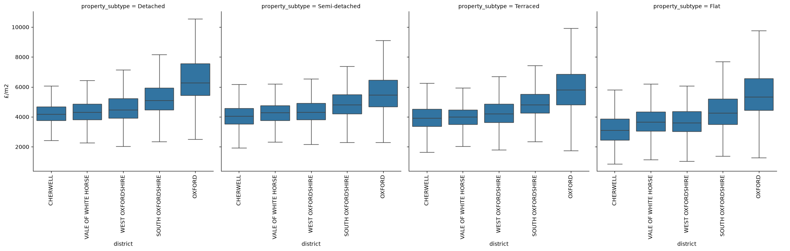
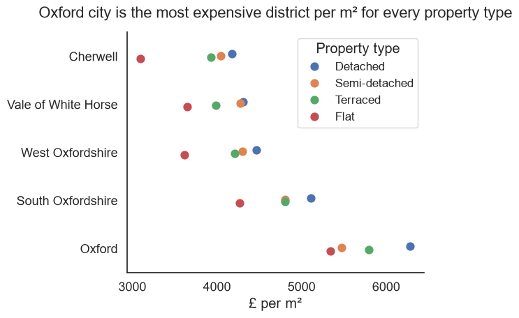

# Oxfordshire house prices dashboard - Day 2 log - visualization

## Reading
Wilke's Fundamentals of Data Visualization [Free online](https://clauswilke.com/dataviz/)
- Skim "Balance the data and the context," "Titles, captions, and tables," "Redundant coding," and "Use larger axis labels."
    - Balance the data and the context
        - Minimise non-data ink (within reason)
    - Titles, captions, and tables
        - titles are important. Title in the caption is good unless figure will be shared without the caption
        - axis/legend titles can be omitted if obvious e.g. years on x, large company labels in legend. Can be overlabelled 
        - tables
            - no vertical lines, no horizontal lines between data
            - left align text, right align numbers. single characters cols centred. Headers aligned with data
        - Redundant coding
            - Identifying features by colour only can make charts difficult to read, best to have some redundancy 
                - marker shape and colour changes
                - line colour and matching order in legend
                - direct labelling of lines or ellipses (around clusters) can allow no legend
        - Use larger axis labels
            - defaults are always too small
            - can be too big if out of balance with other elements (e.g. markers)

## Chart 1
### Before 
- Box plot from day 1

### After

Changes:
- Horizontal layout easier to read
- Changed to a pointplot to allow easier comparison between districts, rather than vertical panels
- Error bars not used as headline is Oxford vs Cherwell, they confuse the message
- Sorted districts by median
- Reordered property types to put all houses together, from largest to smallest type
- Changed m2 to m²
- Key finding in headline

