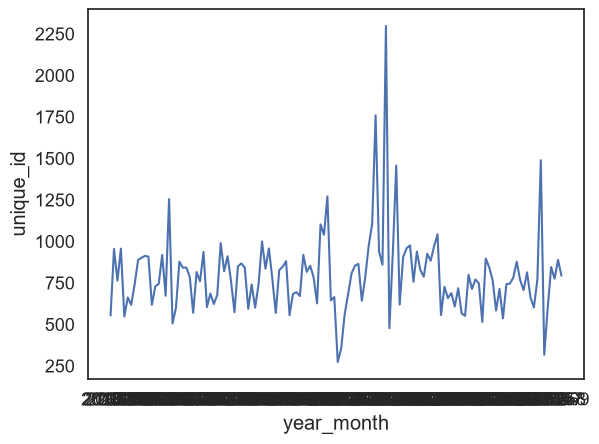
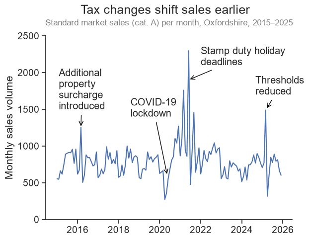

# Oxfordshire house prices dashboard - Day 2 log - visualization

## Reading
Wilke's Fundamentals of Data Visualization [Free online](https://clauswilke.com/dataviz/)
- Skim "Balance the data and the context," "Titles, captions, and tables," "Redundant coding," and "Use larger axis labels."
    - Balance the data and the context
        - Minimise non-data ink (within reason)
    - Titles, captions, and tables
        - titles are important. Title in the caption is good unless figure will be shared without the caption
        - axis/legend titles can be omitted if obvious e.g. years on x, large company labels in legend. Can be overlabelled 
        - tables
            - no vertical lines, no horizontal lines between data
            - left align text, right align numbers. single characters cols centred. Headers aligned with data
        - Redundant coding
            - Identifying features by colour only can make charts difficult to read, best to have some redundancy 
                - marker shape and colour changes
                - line colour and matching order in legend
                - direct labelling of lines or ellipses (around clusters) can allow no legend
        - Use larger axis labels
            - defaults are always too small
            - can be too big if out of balance with other elements (e.g. markers)

## Chart 1
### Before 
- Box plot from day 1

### After

Changes:
- Horizontal layout easier to read
- Changed to a pointplot to allow easier comparison between districts, rather than vertical panels
- Error bars not used as headline is Oxford vs Cherwell, they confuse the message
- Sorted districts by median
- Reordered property types to put all houses together, from largest to smallest type
- Changed m2 to m²
- Key finding in headline

## Chart 2
### Before 
- Initial exploratory plot

### After

Changes:
- Monthly counts built with resample('MS') on deed_date
- y-axis starts at zero and has clear label "Monthly sales volume"
- Yearly x-axis labels, with tick marks shown and no axis title needed
- Annotations: additional property surcharge (2016), COVID-19 lockdown (2020), stamp duty holiday deadlines (2021), thresholds reduced (2025)
    - Dropped "Thresholds increased" (2022): though I suspect the broad bump is resulting from this, it is less clear than the other annotations.
    - Arrows placed beside peaks and troughs rather than on them, to avoid obscuring the trace
- Headline revised: "Monthly sales follow a consistent pattern" (vague) became "Tax changes shift sales into the preceding month" (too precise, as 2021 spikes were spread over several months), and finally "Tax changes shift sales earlier"
- Subtitle added: "Standard market sales (cat. A) per month, Oxfordshire, 2015–2025"

### Other
- Month-by-year overlay plot saved as the "before" for the seasonality chart (question 3)

