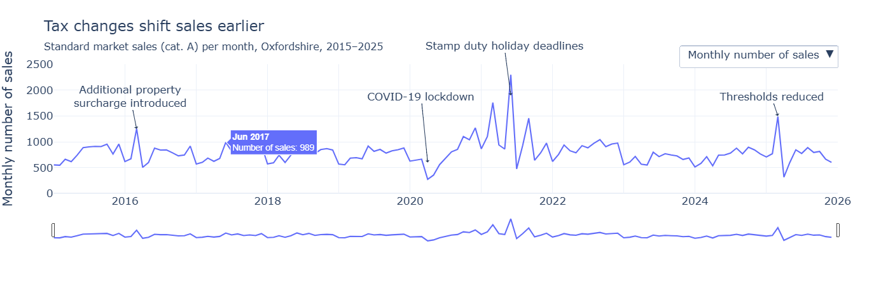
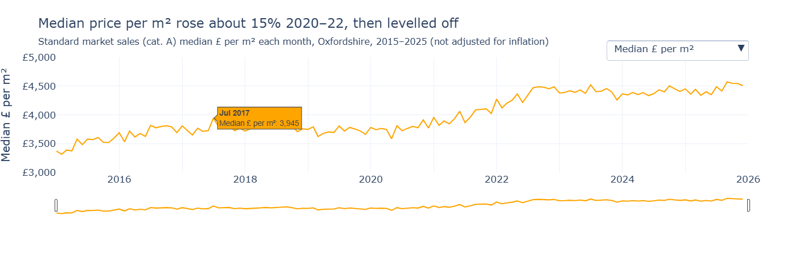

# Oxfordshire house prices dashboard - Day 4 log - Plotly Graph Objects

Adding dropdown and range slider to Chart 2 (sales volumes over time)

- Calculated monthly median £ per m2 with a resample. Chose this over median price_paid to remove effects of fluctuations in size of properties being sold.
- Added a trace for 'Median £ per m2' in orange to stop confusion with original trace
- Added buttons for 'Monthly number of sales' and 'Median £ per m2'
    - Toggle trace visible
    - Change title, subtitle, yaxis title, yaxis.range, annotations and yaxis.tickprefix
        - Volume has y-axis starting at zero but chose to start from £3000 for price to make the trend easier to see
        - Annotations hidden in price view as not relevant
- Title for price trace
    - Initially described as a steady increase but changed as trend is flat with sharp increase in middle
    - Calculated yearly medians to give specific percentage for increase, as monthly values are noisy. 15% from 2020 to 2022 and 2% from 2022 to 2025
    - Added caveat to subtitle, not adjusted for inflation  
- Hid displayModebar as not needed with range slider
- Added range slider to allow closer investigation of date sections
- Added a different tooltip to the new trace
- 2 bugs fixed
    - Price trace was initially visible, just out of range in volume button
    - £ prefix stayed on volume axis after switching back

